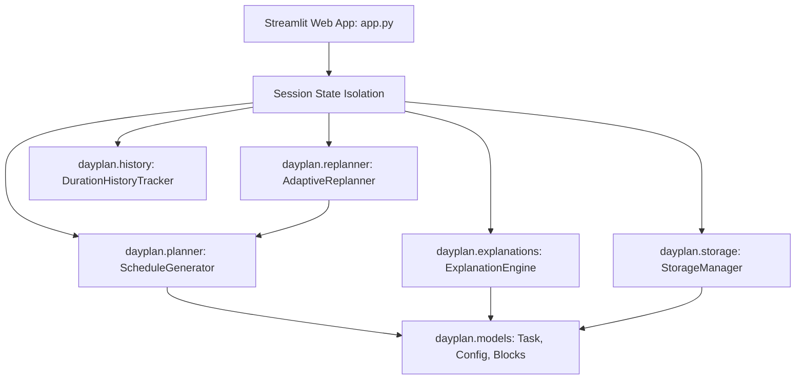

# 📅 DayPlan — The Adaptive Daily Planning Agent

> **An intelligent, explainable daily planning agent that adapts when your day doesn't go according to plan.**

[](https://github.com/your-username/DayPlan/actions)
[](LICENSE)
[](https://www.python.org/downloads/)
[](https://streamlit.io)

---

## 🌟 Product Vision

Unlike traditional, static to-do lists that crumble when morning tasks run late or unexpected interruptions strike, **DayPlan** is an **adaptive planning agent**. It dynamically recalculates your remaining schedule while preserving your completed work, respecting deadlines, honoring mandatory rest breaks, and minimizing unnecessary schedule churn.

Most importantly, DayPlan is **100% transparent and explainable**: every task movement, postponement, or deadline warning is tied to deterministic mathematical rules and explained in plain English—with zero hallucination, zero paid API keys, and zero external subscriptions required.

---

## ✨ Standout Features

- **⚡ Adaptive Rescheduling Engine**: When a morning task runs 45 minutes over or an emergency hits at 13:00, click **"Replan My Day"**. DayPlan locks completed work, shifts downstream tasks smoothly, and recalculates available free buffers.
- **🛡️ Schedule Stability Optimization**: Tracks a **Stability Score** (0–100%) to prevent unnecessary schedule volatility; tasks are kept at their planned slots whenever possible.
- **🧠 "Why This Plan?" Explainability**: Provides clear, rule-derived reasoning for every block on the timeline (e.g. *"Moved by +30m because prerequisite task took 30m longer than estimated"*).
- **⚠️ Honest Deadline & Feasibility Checks**: Never claims an impossible deadline can be met. Tasks that cannot fit before the day ends are explicitly flagged with exact missing minute metrics.
- **☕ Built-in Rest Breaks & Fixed Commitments**: Automatically schedules rest breaks after sustained focus blocks and locks non-negotiable appointments (meetings, lunch) so work never overlaps them.
- **🔗 Task Dependency & Cycle Detection**: Respects prerequisite ordering and utilizes Kahn's algorithm (topological sorting) to safely detect and flag dependency cycles.
- **📈 Duration Intelligence Tracker**: Records planned vs. actual durations to compute empirical category multipliers (e.g. *"Coding tasks historically take 1.25x estimated"*), requiring at least 3 samples before suggesting calibrated durations.
- **🔒 Isolated Privacy by Default**: Runs purely in the browser session (`st.session_state`). No shared multi-user server database leaks your personal tasks. Portable JSON export and import allows instant backup and restore.

---

## 🏛️ System Architecture



### Module Breakdown

| Module | Role |
| :--- | :--- |
| `app.py` | Modern Streamlit dashboard, metric cards, timeline renderer, and interactive controls. |
| `dayplan/models.py` | Strongly typed dataclasses (`Task`, `DayPlanConfig`, `ScheduledBlock`, `ChangeSummary`) with validation. |
| `dayplan/planner.py` | Deterministic greedy scheduler with topological cycle detection and break insertion. |
| `dayplan/replanner.py` | Adaptive replanning engine that anchors completed work and computes diffs with stability scoring. |
| `dayplan/explanations.py` | Plain-English reasoning generator translating scheduler decisions into human explanations. |
| `dayplan/history.py` | Empirical duration tracking, sample-threshold checks (N ≥ 3), and duration calibration. |
| `dayplan/storage.py` | Validated, schema-checked JSON export and import. |
| `dayplan/presets.py` | 7 reproducible benchmark and demonstration scenarios. |
| `evaluate.py` | Automated benchmark script measuring coverage, conflicts, stability, and runtime. |

---

## 🚀 Getting Started Locally

### 1. Prerequisites
- Python 3.11, 3.12, 3.13, or 3.14
- Git

### 2. Clone the Repository
```bash
git clone https://github.com/<YOUR-USERNAME>/DayPlan.git
cd DayPlan
```

### 3. Create and Activate Virtual Environment
```bash
# macOS / Linux
python3 -m venv .venv
source .venv/bin/activate

# Windows (Command Prompt)
python -m venv .venv
.venv\Scripts\activate.bat
```

### 4. Install Dependencies
```bash
pip install -r requirements.txt
```

### 5. Launch the Application
```bash
streamlit run app.py
```
Open your browser to `http://localhost:8501`.

---

## 🧪 Automated Testing & Benchmarks

Run the complete test suite (30 unit and integration tests covering all constraints, edge cases, and cycle detection):

```bash
pytest -v
```

Run the benchmark evaluation script to measure runtime, coverage, conflicts, and stability across all 7 scenarios:

```bash
python evaluate.py
```

### Benchmark Summary (Measured Results)
```text
======================================================================================
Scenario                               | Coverage   | Conflicts  | Stability  | Runtime   
--------------------------------------------------------------------------------------
1. Normal Productive Day               | 100.0%     | 0          | 100%       | 0.26 ms
2. Missed Morning Task (Late Start)    | 80.0%      | 0          | 0%         | 0.19 ms
3. Task Taking Longer Than Expected    | 100.0%     | 0          | 0%         | 0.13 ms
4. Urgent Critical Task Added Mid-Day  | 100.0%     | 0          | 0%         | 0.11 ms
5. Blocked Prerequisite Dependency     | 50.0%      | 0          | 100%       | 0.06 ms
6. Impossible Deadline (Honest Warning)| 100.0%     | 0          | 100%       | 0.11 ms
7. Insufficient Remaining Time         | 50.0%      | 0          | 100%       | 0.08 ms
======================================================================================
```

---

## 📖 Guided Scenario Walkthrough

To see the adaptive rescheduling engine in action, open the app and use the **Quick Demo Presets** dropdown in the sidebar:

1. **Normal Productive Day**: Observe how 5 tasks, a 1-hour lunch commitment, and a 15-minute rest break are placed without conflict.
2. **Task Taking Longer Than Expected**: Task `T-301` planned for 60m took 120m. Notice that `T-301` is locked in place as completed, and subsequent tasks automatically slide forward by +60m.
3. **Urgent Critical Task Added**: An emergency security CVE arrives at 13:00. The agent immediately schedules it ahead of non-urgent tasks, preserving completed morning work.
4. **Impossible Deadline**: A 2-hour task due at 10:00 AM is flagged with a clear warning: *"Missing deadline by 60 minutes"*.

---

## ⚠️ Known Limitations & Design Trade-offs

1. **Heuristic Greedy Scheduler**: DayPlan uses an urgent-first greedy heuristic. While fast (<1 ms) and explainable, it does not guarantee a globally optimal bin-packing solution for complex multi-knapsack schedules.
2. **Single-Day Scope (MVP)**: Schedules operate within a single calendar day (overnight shifts spanning past midnight are not supported in version 1.0).
3. **Browser Session Isolation**: Free Streamlit Cloud instances clear session memory on container sleep. Users must use the JSON export feature to persist plans across browser sessions.

---

## 🗺️ Roadmap & Next Steps

- [ ] **Multi-Day Planning**: Extending availability windows across a 7-day rolling horizon.
- [ ] **Calendar Integration**: One-click sync with Google Calendar or Apple iCal via `.ics` export.
- [ ] **Optional Local LLM Assistant**: Natural language task entry (e.g. *"Schedule 45 mins of code review after lunch"*) using local models (Ollama).
- [ ] **Energy-Level Slotting**: Automatically matching deep-focus tasks to peak morning energy hours.

---

## 📄 License

This project is licensed under the [MIT License](LICENSE).
